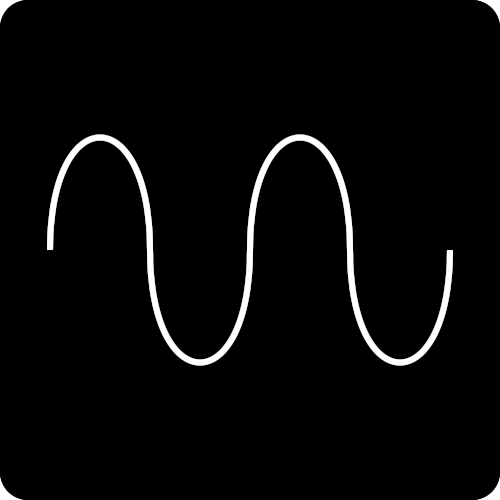
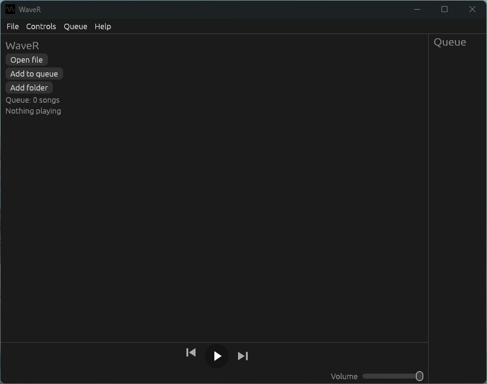

<p align="center">
  
</p>

<h1 align="center">WaveR</h1>
<p align="center">A simple, cozy local music player.</p>
<p align="center"><sub>Pronounced Wave-R</sub></p>

<p align="center">
  <picture><source media="(prefers-color-scheme: dark)" srcset="https://www.shieldcn.dev/github/release/FRANORDE/WaveR.svg?size=sm&amp;mode=dark&amp;font=jetbrains-mono"></picture>
  <picture><source media="(prefers-color-scheme: dark)" srcset="https://www.shieldcn.dev/github/last-commit/FRANORDE/WaveR.svg?variant=secondary&amp;size=sm&amp;mode=dark&amp;font=jetbrains-mono"></picture>
  <picture><source media="(prefers-color-scheme: dark)" srcset="https://www.shieldcn.dev/github/license/FRANORDE/WaveR.svg?variant=ghost&amp;size=sm&amp;mode=dark&amp;font=jetbrains-mono"></picture>
  <picture><source media="(prefers-color-scheme: dark)" srcset="https://www.shieldcn.dev/github/commits/FRANORDE/WaveR.svg?variant=secondary&amp;size=sm&amp;mode=dark&amp;font=jetbrains-mono"></picture>
</p>
<p align="center"><sub>Translations are also available for <a href="https://github.com/FRANORDE/WaveR/blob/main/.github/lang/README-it.md">Italiano</a></sub></p>   

# Features

Plays mp3, flac, wav and ogg files

### Queue

When selecting a folder, WaveR will automatically put all the songs in the queue.
Alternively, you can use the `Add to queue` button and select the songs you want.
You can remove songs from the queue using the `X` button next to them.

### Volume

In the bottom-right corner, you can find the volume bar.
The volume slider only changes WaveR’s volume, not the system volume.

### Language

The interface is available in English and Italiano.
You can switch it anytime from the **Language** menu in the top bar.

# Installation

## Windows

Download the latest `WaveR-Setup-<version>.exe` from the [releases page](https://github.com/FRANORDE/WaveR/releases/latest) (use releases! Downloading the code directly might be unstable).

Run the installer and follow the wizard. By default WaveR is installed in `%USERPROFILE%\.waver` and no administrator rights are needed.

The wizard lets you choose:
- whether to create a desktop shortcut (a Start Menu entry is always created)

> **Note:** since the installer is not code-signed, Windows SmartScreen may show a warning the first time.
> Click **More info → Run anyway**.

### Uninstall

Use **Settings → Apps → Installed apps** and remove WaveR.

## Scoop (Windows)

Requires [Scoop](https://scoop.sh/) installed

---

```
scoop bucket add franorde https://github.com/FRANORDE/scoop-bucket
scoop install waver
```

### Uninstall

```
scoop uninstall waver
scoop bucket rm franorde
```

---

More info at [scoop-bucket](https://github.com/FRANORDE/scoop-bucket/tree/main#installation)

## Linux

WaveR runs on Linux too, starting from version 2.0.0.

### Debian / Ubuntu

Download `WaveR_<version>_amd64.deb` from the [releases page](https://github.com/FRANORDE/WaveR/releases/latest) and install it:

```
sudo apt install ./WaveR_<version>_amd64.deb
```

The `.deb` pulls in its runtime dependencies (ALSA, GTK 3) by itself.

### AppImage

Download `WaveR_<version>_x86_64.AppImage` from the [releases page](https://github.com/FRANORDE/WaveR/releases/latest), make it executable and run it:

```
chmod +x WaveR_<version>_x86_64.AppImage
./WaveR_<version>_x86_64.AppImage
```

> If your distro lacks FUSE, run it with `--appimage-extract-and-run`.

### Portable tar.gz

Download `WaveR_<version>-linux-x86_64.tar.gz` from the [releases page](https://github.com/FRANORDE/WaveR/releases/latest), extract it and run the `WaveR` binary.
It requires ALSA and GTK 3 installed on the system.

### Arch Linux

Download `PKGBUILD` and the `WaveR_<version>_x86_64.tar.gz` source tarball from the [releases page](https://github.com/FRANORDE/WaveR/releases/latest) into the same folder, then build and install:

```
makepkg -fi
```

### Uninstall

- `.deb`: `sudo apt remove wave-r`
- AppImage and tar.gz: just delete the file or folder

# Usage

Open WaveR from the Start Menu or your desktop shortcut (if created).
Then select `Open file` or `Add folder` and select your song/folder.

<p>
  
</p>

# Building from source

This is only needed if you want to compile WaveR yourself.

**Prerequisite:** [Rust](https://rustup.rs) and [Git](https://git-scm.com/install/) must be installed.
On Linux, building also needs the ALSA and GTK 3 development packages (e.g. on Debian/Ubuntu: `sudo apt install libasound2-dev libgtk-3-dev pkg-config`).

```
git clone https://github.com/FRANORDE/WaveR.git
cd WaveR
cargo build --release
```

The executable will be in `target/release/` (`WaveR.exe` on Windows, `WaveR` on Linux).

# Notes, credits and licenses

## Notes

- Some AI was used for development, but the code was manually reviewed and tested.
- Free and open-source software is the best software forever.

## Thanks to

- [Inno Setup](https://jrsoftware.org/isinfo.php) for the great installer system
- [egui/eframe](https://github.com/emilk/egui) for the simple GUI
- [rodio](https://github.com/RustAudio/rodio) for the rust audio playback library
- [rfd](https://github.com/PolyMeilex/rfd) for the native file dialogs
- You, for using WaveR!

## Licenses

After installing with the installer, all licenses can also be found in the `licenses` folder next to the app.

----

WaveR is released under the [MIT License](../LICENSE).

WaveR is built with [egui/eframe](https://github.com/emilk/egui) and other open-source Rust libraries. Their licenses (mostly MIT and Apache-2.0) are listed in [THIRD-PARTY-NOTICES.txt](../licenses/THIRD-PARTY-NOTICES.txt).

### Trademarks

WaveR is an independent community project and is not affiliated with other apps or products that share a similar name.
