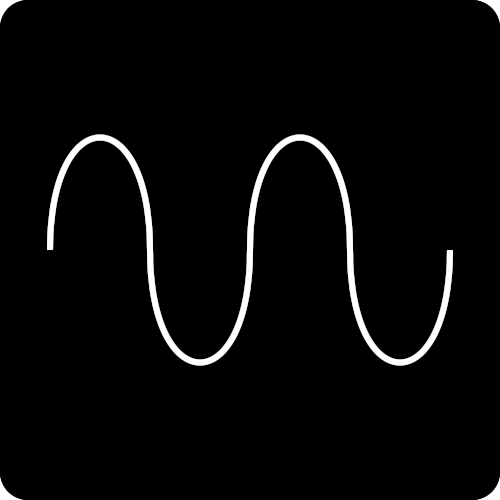
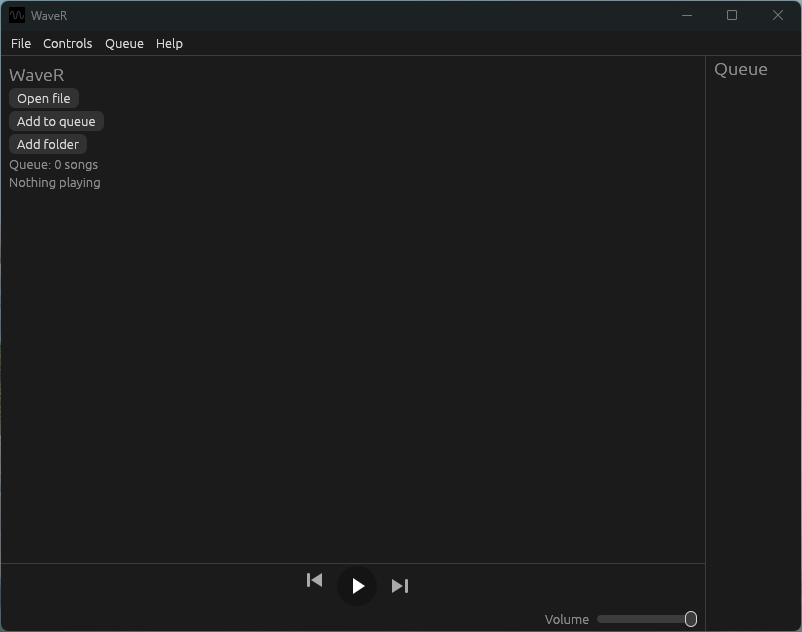

<p align="center">
  
</p>

<h1 align="center">WaveR</h1>
<p align="center">Un lettore musicale locale semplice e accogliente.</p>
<p align="center"><sub>Si pronuncia Wave-R</sub></p>

<p align="center">
  <picture><source media="(prefers-color-scheme: dark)" srcset="https://www.shieldcn.dev/github/release/FRANORDE/WaveR.svg?size=sm&amp;mode=dark&amp;font=jetbrains-mono"></picture>
  <picture><source media="(prefers-color-scheme: dark)" srcset="https://www.shieldcn.dev/github/last-commit/FRANORDE/WaveR.svg?variant=secondary&amp;size=sm&amp;mode=dark&amp;font=jetbrains-mono"></picture>
  <picture><source media="(prefers-color-scheme: dark)" srcset="https://www.shieldcn.dev/github/license/FRANORDE/WaveR.svg?variant=ghost&amp;size=sm&amp;mode=dark&amp;font=jetbrains-mono"></picture>
  <picture><source media="(prefers-color-scheme: dark)" srcset="https://www.shieldcn.dev/github/commits/FRANORDE/WaveR.svg?variant=secondary&amp;size=sm&amp;mode=dark&amp;font=jetbrains-mono"></picture>
</p>

# Funzionalità

Riproduce file mp3, flac, wav e ogg

### Coda

Quando selezioni una cartella, WaveR inserirà automaticamente tutti i brani nella coda.
In alternativa, puoi usare il pulsante `Aggiungi alla coda` e selezionare i brani che desideri.
Puoi rimuovere i brani dalla coda usando il pulsante `X` accanto ad essi.

### Volume

Nell'angolo in basso a destra puoi trovare la barra del volume.
Il cursore del volume modifica solo il volume di WaveR, non quello del sistema.

# Installazione

## Installatore

Scarica l'ultimo `WaveR-Setup-<version>.exe` dalla [pagina delle release](https://github.com/FRANORDE/WaveR/releases/latest) (usa le release! Scaricare direttamente il codice potrebbe risultare instabile).

Esegui l'installatore e segui la procedura guidata. Per impostazione predefinita WaveR viene installato in `%USERPROFILE%\.waver` e non sono necessari i diritti di amministratore.

La procedura guidata ti permette di scegliere:
- se creare un collegamento sul desktop (viene sempre creata una voce nel Menu Start)

> **Nota:** poiché l'installatore non è firmato digitalmente, Windows SmartScreen potrebbe mostrare un avviso la prima volta.
> Clicca su **Ulteriori informazioni → Esegui comunque**.

### Disinstallazione

Usa **Impostazioni → App → App installate** e rimuovi WaveR.

## Scoop

Richiede [Scoop](https://scoop.sh/) installato

---


```
scoop bucket add franorde https://github.com/FRANORDE/scoop-bucket
scoop install waver
```

### Disinstallazione

```
scoop uninstall waver
scoop bucket rm franorde
```

---

Maggiori informazioni su [scoop-bucket](https://github.com/FRANORDE/WaveR/releases/latest/tree/main#installation)

# Utilizzo

Apri WaveR dal Menu Start o dal collegamento sul desktop (se creato).
Quindi seleziona `Apri file` o `Aggiungi cartella` e seleziona il tuo brano o la tua cartella.

<p>
  
</p>

# Compilazione dal codice sorgente

Questo è necessario solo se vuoi compilare WaveR da solo.

**Prerequisito:** Devono essere installati [Rust](https://rustup.rs) e [Git](https://git-scm.com/install/).

```
git clone https://github.com/FRANORDE/WaveR.git
cd WaveR
cargo build --release
```

L'eseguibile si troverà in `target\release\WaveR.exe`.

# Note, riconoscimenti e licenze

## Note

- È stata utilizzata un po' di IA per lo sviluppo, ma il codice è stato revisionato e testato manualmente.
- Il software libero e open-source è il miglior software in assoluto.

## Ringraziamenti a

- [Inno Setup](https://jrsoftware.org/isinfo.php) per l'ottimo sistema di installazione
- [egui/eframe](https://github.com/emilk/egui) per la semplice interfaccia grafica (GUI)
- [rodio](https://github.com/RustAudio/rodio) per la libreria di riproduzione audio in Rust
- [rfd](https://github.com/PolyMeilex/rfd) per le finestre di dialogo native dei file
- Tu, per aver scelto di usare WaveR!

## Licenze

Dopo l'installazione tramite l'installatore, tutte le licenze possono essere trovate anche nella cartella `licenses` accanto all'applicazione.

----

WaveR è rilasciato sotto [Licenza MIT](../LICENSE).

WaveR è realizzato con [egui/eframe](https://github.com/emilk/egui) e altre librerie open-source in Rust. Le loro licenze (principalmente MIT e Apache-2.0) sono elencate in [THIRD-PARTY-NOTICES.txt](../licenses/THIRD-PARTY-NOTICES.txt).

### Marchi registrati

WaveR è un progetto indipendente della community e non è affiliato con altre app o prodotti che condividono un nome simile.
